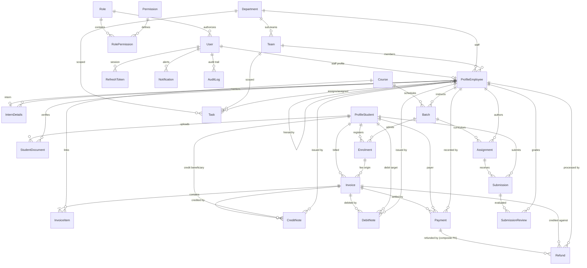

# SEG Academy CRM — Database Architecture Design (Phase 2C.2 Final Refinement)

**Document Version:** 2.1.0 (Final Architecture Corrections)  
**Status:** PROPOSED & VALIDATED (Awaiting Review & Approval)  
**Database Engine:** Supabase PostgreSQL 17.11 (Mumbai `ap-south-1`)  
**ORM:** Prisma ORM `6.19.3`  
**Reference Schema:** [`packages/database/prisma/schema.proposed.prisma`](file:///c:/Users/thei2s/OneDrive/문서/Desktop/Seg-CRM/packages/database/prisma/schema.proposed.prisma)

---

## 1. Executive Summary & Scope Clarifications

This document establishes the final architectural design for **SEG Academy CRM** following Phase 2C.2 corrections.

### 1. Internal Employee-Only CRM (No Student Portal Authentication)
- **Design Decision:** SEG CRM is strictly an internal operations CRM for SEG Academy staff, administrators, trainers, and leadership.
- **Removal of Student Portal Authentication:**
  - `STUDENT` is completely removed from the system `Role` seed list and authorization logic.
  - The `User` model represents **internal employees and staff only**. No student credentials, password hashes, or JWT refresh tokens are created.
  - `ProfileStudent` (`students` table) is preserved as an **independent business record** containing student identity, contact info (`fullName`, `email`, `phoneNumber`, `studentCode`), guardian data, and relationships to enrolments, invoices, payments, and coursework submissions.
- **Workflow Scope:**
  $$\text{Student Registration} \longrightarrow \text{Course Selection} \longrightarrow \text{Batch Assignment} \longrightarrow \text{Enrolment} \longrightarrow \text{Invoice} \longrightarrow \text{Payment}$$

### 2. Lead Management Excluded
- No `Lead`, `FollowUp`, or `LeadSource` models exist.
- Inquiry funnels and marketing conversion stages are deferred to future milestones.

---

## 2. Comprehensive Resolution of Architecture Review Points

### A. Internal Unified RBAC Model
The authorization system is consolidated into one authoritative model:
- `User.roleId` references `Role.id` (`onDelete: Restrict`). Each user has exactly one authoritative role.
- **System Roles (`Role.code`):**
  1. `FOUNDER_SUPER_ADMIN`: Unrestricted global system bypass.
  2. `ADMIN`: Full management of departments, teams, courses, batches, and personnel.
  3. `TEAM_LEADER`: Operational management scoped strictly to assigned `Team` and `Department`.
  4. `FINANCE_MANAGER`: Exclusive control over billing, credit/debit notes, payment logging, and refund approvals.
  5. `EMPLOYEE_INTERN`: Daily task handling, document verification assistance, student record updates.
  6. `TRAINER_FACULTY`: Academic instruction; scoped to assigned `Batch` cohorts, assignments, and submissions.
- **Fine-Grained Capabilities:** `Role` connects to `Permission` (`resource:action`) via `RolePermission`.
- **Organizational Data Scoping:** Queries apply department and team scoping via `ProfileEmployee.departmentId`, `ProfileEmployee.teamId`, and hierarchical reporting via `ProfileEmployee.managerId`.

---

### B. End-to-End Financial Idempotency Architecture

To prevent duplicate financial transactions caused by user double-clicks, network drops, or gateway webhook retries:

#### 1. Uniqueness Scope
- Every `Payment` and `Refund` row enforces `idempotencyKey String @unique` (strictly non-nullable).
- **Scope:**
  - **Gateway Payments (Razorpay/Stripe):** The unique gateway payment intent ID or order ID (`gatewayOrderId`).
  - **API/Client Invocations:** A client-generated `UUIDv4` provided in the HTTP request header (`Idempotency-Key`).
  - **Manual/Cash Records:** Derived uniquely by the backend as: `MANUAL_{invoiceId}_{timestamp}_{recorderId}`.

#### 2. Duplicate Request Payload Verification (`idempotencyPayloadHash`)
- Naive idempotency keys can be abused if a client reuses an old key with modified financial parameters.
- **Protection:** Both `Payment` and `Refund` store `idempotencyPayloadHash String?` (SHA-256 hash of `amount + currency + invoiceId + method + studentId`).
- **Processing Logic:**
  1. When an incoming request presents an existing `idempotencyKey`:
     - Database triggers unique constraint `P2002` (code `23505`).
     - Application queries the existing record and computes the payload hash of the incoming request.
     - **If Payload Hash Matches:** The request is verified as a safe retry. The system returns the existing transaction record (`HTTP 200 OK / 201 Replayed`) without executing another transaction.
     - **If Payload Hash Differs:** A conflict or tampering attempt is detected. The application rejects the request immediately with `HTTP 409 Conflict` ("Idempotency key already used for a different financial payload").

#### 3. Concurrent Request Handling
- Simultaneous requests presenting the same key are serialized at the PostgreSQL unique B-tree index level.
- One request succeeds and commits; all concurrent duplicates immediately fail on `UNIQUE (idempotency_key)` and roll back, eliminating duplicate payment capture.

---

### C. Financial Business Rules & Verification Strategy

To guarantee absolute financial integrity, validation is partitioned across three distinct defense layers:

```
┌────────────────────────────────────────────────────────────────────────┐
│                        THREE-TIER FINANCIAL INTEGRITY                  │
│                                                                        │
│  [ Tier 1: Application-Level Transactional Validation ]               │
│  - Optimistic/Pessimistic locking (SELECT FOR UPDATE)                  │
│  - Over-payment and refund threshold checks                            │
│  - Credit/Debit note validation                                        │
│  - Idempotency hash verification                                       │
│                                                                        │
│  [ Tier 2: Proposed PostgreSQL Triggers (Migration Phase) ]            │
│  - Block updates to financial columns on CONFIRMED payments            │
│  - Block updates to financial columns on PROCESSED refunds             │
│  - Block row deletions on confirmed records                            │
│                                                                        │
│  [ Tier 3: PostgreSQL Database-Level Constraints ]                     │
│  - DECIMAL(12, 2) exact precision                                      │
│  - UNIQUE(idempotency_key)                                             │
│  - Composite FK: FOREIGN KEY (payment_id, invoice_id) REFERENCES...   │
│  - ON DELETE RESTRICT on all financial relationships                   │
└────────────────────────────────────────────────────────────────────────┘
```

#### Rule 1: Refund Threshold Limit
- **Rule:** A refund cannot exceed the remaining refundable amount of the parent payment:
  $$\text{Remaining Refundable} = \text{Payment.amount} - \sum(\text{Existing Processed Refunds for this Payment})$$
- **Enforcement:** Enforced within an atomic `prisma.$transaction` using pessimistic locking:
  ```ts
  // 1. Lock payment row to prevent concurrent race condition
  const [payment] = await prisma.$queryRaw<Payment[]>`
    SELECT id, amount, status FROM payments WHERE id = ${paymentId} FOR UPDATE
  `;
  // 2. Compute existing refunds sum
  const existingRefunds = await prisma.refund.aggregate({
    where: { paymentId, status: 'PROCESSED' },
    _sum: { amount: true },
  });
  const refundable = payment.amount.minus(existingRefunds._sum.amount ?? 0);
  if (requestedRefundAmount.greaterThan(refundable)) {
    throw new BadRequestException('Refund amount exceeds remaining refundable balance.');
  }
  ```

#### Rule 2: Over-Payment Protection
- **Rule:** Total confirmed payments cannot exceed the adjusted invoice amount unless an explicitly approved advance-payment policy is flagged:
  $$\sum(\text{Confirmed Payments}) \le \text{Adjusted Invoice Total}$$
- **Enforcement:** Before creating or confirming a payment, the application locks the parent `Invoice` row (`SELECT ... FOR UPDATE`), computes the outstanding balance, and rejects payments exceeding the balance due unless authorized by a Finance Manager.

#### Rule 3: Concurrent Payments & Refunds Race-Condition Prevention
- If two payments or a payment and a refund execute simultaneously on the same invoice, uncoordinated reads could produce invalid balances.
- **Enforcement:** All mutations acquire row-level locks on the target `Invoice` (`FOR UPDATE`). Transactions are serialized, ensuring each calculation operates on committed, up-to-date balances.

#### Rule 4: Controlled CreditNote & DebitNote Status Workflows
- **CreditNote Status Flow:** `DRAFT` $\longrightarrow$ `ISSUED` $\longrightarrow$ `APPLIED` (or `CANCELLED`).
  - Cannot be applied if `CreditNote.amount > Invoice.outstandingBalance`.
- **DebitNote Status Flow:** `DRAFT` $\longrightarrow$ `ISSUED` $\longrightarrow$ `APPLIED` (or `CANCELLED`).
  - Upon transition to `APPLIED`, increments the invoice balance.
- **Double-Entry Balance Formula:**
  $$\text{Adjusted Invoice Total} = \text{totalAmount} + \sum(\text{Applied DebitNotes}) - \sum(\text{Applied CreditNotes})$$
  $$\text{Net Paid Amount} = \sum(\text{Confirmed Payments}) - \sum(\text{Processed Refunds})$$
  $$\text{Outstanding Balance Due} = \text{Adjusted Invoice Total} - \text{Net Paid Amount}$$

---

### D. Proposed PostgreSQL Triggers (For Migration Phase)

> [!IMPORTANT]
> **Trigger Status:** The triggers documented below are **proposed for execution in the subsequent migration phase**. They are **not active** in the current phase and will be deployed via Prisma migrate SQL scripts.

#### 1. Confirmed Payment Immutability Trigger
```sql
CREATE OR REPLACE FUNCTION enforce_payment_immutability()
RETURNS TRIGGER AS $$
BEGIN
  -- Prevent deletion of confirmed payments
  IF TG_OP = 'DELETE' THEN
    IF OLD.status = 'CONFIRMED' THEN
      RAISE EXCEPTION 'Financial Security: Confirmed payments cannot be deleted (Payment ID: %).', OLD.id;
    END IF;
    RETURN OLD;
  END IF;

  -- Prevent mutation of financial columns once confirmed
  IF TG_OP = 'UPDATE' AND OLD.status = 'CONFIRMED' THEN
    IF NEW.amount <> OLD.amount OR
       NEW.invoice_id <> OLD.invoice_id OR
       NEW.student_id <> OLD.student_id OR
       NEW.currency <> OLD.currency OR
       NEW.method <> OLD.method OR
       NEW.idempotency_key <> OLD.idempotency_key OR
       NEW.paid_at <> OLD.paid_at THEN
      RAISE EXCEPTION 'Financial Security: Core financial attributes of confirmed payments are immutable.';
    END IF;

    -- Only permit transitions to REFUNDED / PARTIALLY_REFUNDED or note updates
    IF NEW.status NOT IN ('CONFIRMED', 'REFUNDED', 'PARTIALLY_REFUNDED') THEN
      RAISE EXCEPTION 'Financial Security: Invalid status transition for confirmed payment.';
    END IF;
  END IF;

  RETURN NEW;
END;
$$ LANGUAGE plpgsql;

CREATE TRIGGER trg_payment_immutability
BEFORE UPDATE OR DELETE ON payments
FOR EACH ROW EXECUTE FUNCTION enforce_payment_immutability();
```

#### 2. Processed Refund Immutability Trigger
```sql
CREATE OR REPLACE FUNCTION enforce_refund_immutability()
RETURNS TRIGGER AS $$
BEGIN
  IF TG_OP = 'DELETE' THEN
    IF OLD.status = 'PROCESSED' THEN
      RAISE EXCEPTION 'Financial Security: Processed refunds cannot be deleted (Refund ID: %).', OLD.id;
    END IF;
    RETURN OLD;
  END IF;

  IF TG_OP = 'UPDATE' AND OLD.status = 'PROCESSED' THEN
    IF NEW.amount <> OLD.amount OR
       NEW.payment_id <> OLD.payment_id OR
       NEW.invoice_id <> OLD.invoice_id OR
       NEW.currency <> OLD.currency OR
       NEW.idempotency_key <> OLD.idempotency_key OR
       NEW.processed_at <> OLD.processed_at THEN
      RAISE EXCEPTION 'Financial Security: Core attributes of processed refunds are immutable.';
    END IF;
  END IF;

  RETURN NEW;
END;
$$ LANGUAGE plpgsql;

CREATE TRIGGER trg_refund_immutability
BEFORE UPDATE OR DELETE ON refunds
FOR EACH ROW EXECUTE FUNCTION enforce_refund_immutability();
```

#### 3. Invoice Finalization Immutability Trigger
```sql
CREATE OR REPLACE FUNCTION enforce_invoice_finalization()
RETURNS TRIGGER AS $$
BEGIN
  IF TG_OP = 'UPDATE' AND OLD.is_finalized = true THEN
    IF NEW.total_amount <> OLD.total_amount OR
       NEW.subtotal <> OLD.subtotal OR
       NEW.tax_amount <> OLD.tax_amount OR
       NEW.discount_amount <> OLD.discount_amount OR
       NEW.student_id <> OLD.student_id THEN
      RAISE EXCEPTION 'Financial Security: Finalized invoices cannot be directly edited. Issue Credit/Debit Notes.';
    END IF;
  END IF;
  RETURN NEW;
END;
$$ LANGUAGE plpgsql;

CREATE TRIGGER trg_invoice_finalization
BEFORE UPDATE ON invoices
FOR EACH ROW EXECUTE FUNCTION enforce_invoice_finalization();
```

---

## 3. Updated Entity Relationship Diagram (ERD)



---

## 4. Entity & Enum Inventory (26 Models, 17 Enums)

### A. Models (26 Total)
- **Auth & Staffing (9):** `User`, `RefreshToken`, `Role`, `Permission`, `RolePermission`, `Department`, `Team`, `ProfileEmployee`, `InternDetails`
- **Student Operations (2):** `ProfileStudent`, `StudentDocument`
- **Academics (3):** `Course`, `Batch`, `Enrolment`
- **Financial Subledger (6):** `Invoice`, `InvoiceItem`, `CreditNote`, `DebitNote`, `Payment`, `Refund`
- **Workflows & Grading (4):** `Task`, `Assignment`, `Submission`, `SubmissionReview`
- **Messaging & Compliance (2):** `Notification`, `AuditLog`

### B. Enums (17 Total)
`AccountStatus`, `EmploymentType`, `InternshipStatus`, `DocumentType`, `DocumentVerificationStatus`, `BatchStatus`, `EnrolmentStatus`, `InvoiceStatus`, `CreditNoteStatus`, `DebitNoteStatus`, `PaymentMethod`, `PaymentStatus`, `RefundStatus`, `TaskPriority`, `TaskStatus`, `SubmissionStatus`, `NotificationChannel`.

---

## 5. Prisma Schema Validation Output

Validated against [`packages/database/prisma/schema.proposed.prisma`](file:///c:/Users/thei2s/OneDrive/문서/Desktop/Seg-CRM/packages/database/prisma/schema.proposed.prisma) using Prisma CLI `6.19.3`:

```text
> @seg/database@0.1.0 exec
> prisma validate --schema=prisma/schema.proposed.prisma

Environment variables loaded from .env
Prisma schema loaded from prisma\schema.proposed.prisma
The schema at prisma\schema.proposed.prisma is valid 🚀
```

- **Result:** Valid (Exit Code: `0`).
- **Student Portal Authentication:** Completely detached from `User`. `ProfileStudent` is an independent academic record.
- **Lead Models:** 0 (strictly excluded).
- **Composite Key Constraint:** Validated for `[paymentId, invoiceId]` on `Refund`.
- **Decimal Types:** All 11 monetary fields verified.
- **Active Schema Status:** [packages/database/prisma/schema.prisma](file:///c:/Users/thei2s/OneDrive/문서/Desktop/Seg-CRM/packages/database/prisma/schema.prisma) was **not modified**.
- **Database Status:** Zero migrations, zero DDL, zero records written.
